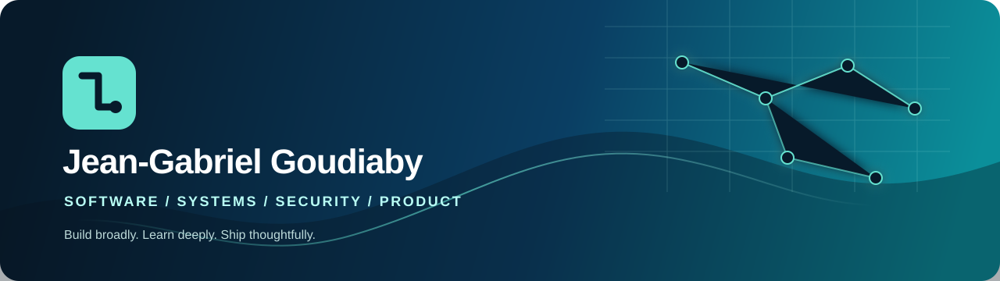
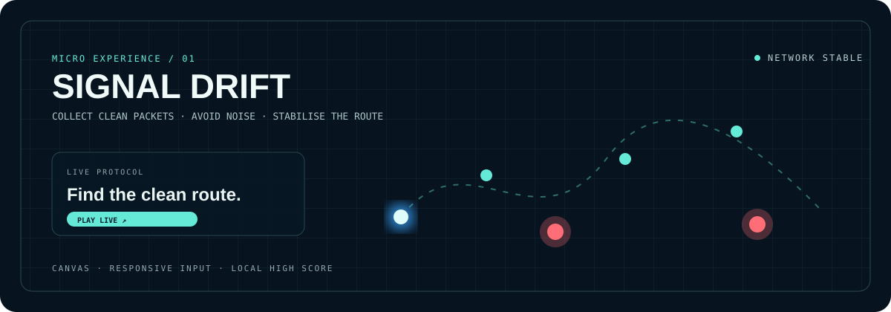

  

<h1 align="center">Jean-Gabriel Goudiaby</h1>

  <strong>Software Developer · Technical Explorer · Product Builder</strong> 
  Full-stack engineering · Systems · Performance · Applied security

  
  
  

  
  
  &nbsp;·&nbsp;
  <a href="#featured-builds">Featured builds</a> · <a href="#technical-toolkit">Toolkit</a> · <a href="#currently-exploring">Now</a>

> I build to understand. My work moves between product interfaces, APIs, systems tooling, distributed applications, networking and security research. I am at my best when a new language, environment or problem needs to become a useful, well-documented piece of software.

<table>
  <tr>
    <td width="50%" valign="top">
      <h3>01 / Build</h3>
      <strong>Product engineering</strong> Web applications, APIs, service flows and cross-platform experiences.  
      <strong>Systems & performance</strong> Rust, Go, Linux, CLI tooling, caching, networking and concurrency.
    </td>
    <td width="50%" valign="top">
      <h3>02 / Explore</h3>
      <strong>Technical range</strong> Backend, frontend, infrastructure, mobile and developer tooling.  
      <strong>Security specialization</strong> Applied security, defensive tooling, network analysis and forensics foundations.
    </td>
  </tr>
</table>

## Featured builds

<table>
  <tr>
    <td width="50%" valign="top">
      <a href="https://github.com/Jeanga7/CacheCraft"><strong>CacheCraft ↗</strong></a> 
      GO · PERFORMANCE ENGINEERING  
      LRU caching, Redis integration and resilient application design.
        
      
      
    </td>
    <td width="50%" valign="top">
      <a href="https://github.com/Jeanga7/buy-01"><strong>buy-01 ↗</strong></a> 
      JAVA · DISTRIBUTED PRODUCT  
      Full-stack commerce platform exploring backend architecture and product delivery.
        
      
      
      
    </td>
  </tr>
  <tr>
    <td width="50%" valign="top">
      <a href="https://github.com/Jeanga7/language-installer"><strong>language-installer ↗</strong></a> 
      SHELL · DEVELOPER EXPERIENCE  
      Practical language-setup automation with a clear developer-experience focus.
        
      
      
    </td>
    <td width="50%" valign="top">
      <a href="https://github.com/Jeanga7/aliouniang--multiplayer-fps"><strong>Multiplayer FPS ↗</strong></a> 
      RUST · REAL-TIME COLLABORATION  
      Collaborative real-time project demonstrating systems thinking and networked-programming exposure.
        
      
      
    </td>
  </tr>
  <tr>
    <td width="50%" valign="top">
      <a href="https://github.com/Jeanga7/edieng--real-time-forum"><strong>Real-time Forum ↗</strong></a> 
      GO · COLLABORATIVE WEB SYSTEM  
      Collaborative web application work with real-time concerns and shared code ownership.
        
      
      
    </td>
    <td width="50%" valign="top">
      <strong>Applied security</strong> 
      DEFENSIVE RESEARCH · LAB WORK  
      Controlled research, defensive tooling, network diagnostics and image analysis. Sensitive lab material stays access-controlled.
        
      
      
    </td>
  </tr>
</table>

<strong>What is behind the public showcase?</strong>

 
Some work is private while it is being documented, hardened for publication or contains sensitive laboratory material. The projects above are selected to show real breadth without exposing unsafe or unfinished content.

## Technical toolkit

<strong>Languages</strong>

  
  
  
  
  
  
  
  
  
  

<strong>Frameworks & platform</strong>

  
  
  
  
  
  
  
  
  

<strong>Read the toolkit honestly</strong>

 
These badges represent technologies I have used across projects, learning tracks and product work. They are not a claim of equal seniority in every technology; repositories and project notes are the evidence of depth.

## Currently exploring

<table>
  <tr>
    <td width="33%"><strong>01 / Curate</strong> Turning real work into clear public evidence.</td>
    <td width="33%"><strong>02 / Build</strong> Systems, product engineering and developer tools.</td>
    <td width="33%"><strong>03 / Learn</strong> Security research with safe, responsible sharing.</td>
  </tr>
</table>

  
  

© Jean-Gabriel Goudiaby · Dakar, Senegal

## Interactive corner

<table>
  <tr>
    <td width="50%" valign="top">
      <a href="https://github.com/Jeanga7/signal-drift"><strong>Signal Drift ↗</strong></a> 
      CANVAS · INTERACTION DESIGN · JAVASCRIPT  
      A playable micro-experience built with responsive pointer input, collision logic and local high-score persistence. It is a compact public study in visual systems, motion and feedback.
        
      
      
    </td>
    <td width="50%" valign="top">
      <strong>Why a micro-game?</strong> 
      PUBLIC BUILD · SMALL SCOPE · REAL EXECUTION  
      It turns a profile into a place to explore—not only a list of links—while demonstrating browser APIs, responsive input handling and purposeful visual polish.
    </td>
  </tr>
</table>

## Work beyond the public repositories

<table>
  <tr>
    <td width="50%" valign="top">
      <strong>ScoutHub-PC</strong> 
      PRODUCT PLATFORM · NEXT.JS · POSTGRESQL · DDD  
      Product work for a public storytelling and youth-programme platform, using Next.js, PostgreSQL/Drizzle and Clean Architecture patterns. Source stays private while the product is developed and reviewed.
    </td>
    <td width="50%" valign="top">
      <strong>Kalend</strong> 
      SCHEDULING SAAS · GO · WORKFLOW DESIGN  
      Appointment and workflow product work focused on backend logic, service design and practical operations. Private because it is a product-in-progress, not an open-source artifact.
    </td>
  </tr>
  <tr>
    <td width="50%" valign="top">
      <strong>0-shell</strong> 
      RUST · SYSTEMS EXPLORATION  
      A systems-oriented shell project exploring command execution, process-facing concepts and robust command-line ergonomics.
    </td>
    <td width="50%" valign="top">
      <strong>Security labs</strong> 
      CONTROLLED RESEARCH · DEFENSIVE LEARNING  
      Sandbox-based reverse-engineering and behavior-analysis exercises used to develop defensive detection thinking. Material that could be misused is intentionally not published.
    </td>
  </tr>
</table>

> **Publication standard.** Private work is represented by accurate architecture, product and learning summaries—not by pretending it does not exist, nor by exposing client material, code or laboratory assets that should remain controlled.

  

<a href="https://jeanga7.github.io/signal-drift/"><strong>▶ Play Signal Drift</strong></a> &nbsp;·&nbsp; <a href="https://github.com/Jeanga7/signal-drift">View source</a>

